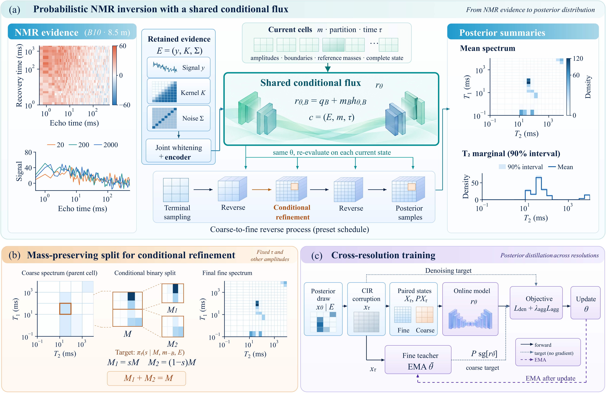

# ReCoDiF

Companion analysis code and parameter settings for **ReCoDiF: A
resolution-consistent diffusion fusion model for probabilistic NMR inversion**.

The executable package rebuilds the manuscript's experimental figures and
tables from the accompanying CSV results. It includes the shared data readers,
plotting and tabulation programs, metric utilities, experimental settings, and
the editable framework figure. Model training/inference programs and trained
checkpoints are not included in this release.

## Method overview



The paper couples three operations:

1. **Shared conditional flux.** Retained observations, the acquisition kernel,
   noise covariance, the complete current cell state, and diffusion time
   condition one spectral flux.
2. **Cross-resolution learning.** Denoising on paired CIR states is combined
   with regression of coarse fluxes to aggregated, stop-gradient fine EMA
   predictions.
3. **Mass-preserving refinement.** Conditional subdivision preserves a parent
   amplitude at fixed diffusion time while retaining the other current cells
   in the conditioning state. Reverse evolution allows total amplitude to vary.

The manuscript framework is supplied as [PDF](assets/Fig1_Framework.pdf) and
[editable PowerPoint](assets/Fig1_Framework_Editable.pptx).

## Installation

Python 3.12 is the tested runtime. No GPU is needed for the analysis commands.

```bash
git clone https://github.com/N2308490G/ReCoDiF.git
cd ReCoDiF
python -m venv .venv
# Linux/macOS: source .venv/bin/activate
# Windows PowerShell: .venv\Scripts\Activate.ps1
python -m pip install -r requirements-lock.txt
```

The manuscript uses Times New Roman. Install that font for matching typography.
To run on a machine without it, explicitly choose the bundled Matplotlib font
with `--font "DejaVu Serif"`; numerical values are unchanged, but typography
differs. Fonts are not redistributed in this repository.

## Reproduce the manuscript outputs

```bash
# Nine experimental figures, eight generated tables, two static protocol tables,
# numerical LaTeX macros, and a copy of the supplied framework PDF:
python main.py all

# Tables and numerical macros only:
python main.py tables

# One experimental figure (paper numbering):
python main.py figures --only fig3

# Portable-font example and a separate output directory:
python main.py all --font "DejaVu Serif" --out outputs/portable
```

Outputs are written to `outputs/figures`, `outputs/tables`, and `outputs/macros`.
Experimental figures are exported as PDF, PNG, and SVG. Figure 1 is a supplied
illustration and is copied without regeneration. The input CSV files are read
without modification. `--data-dir` selects another directory with the same
layout. Commands stop and report the failing program if any generation step
fails.

## Implementation map

| Manuscript output | Program |
|---|---|
| Fig. 2: measured B10 signals | `scripts/generate_borehole_figure.py` |
| Fig. 3: B10 NMR spectra | `scripts/generate_b10_nmr_figure.py` |
| Fig. 4: B10 marginals and predictions | `scripts/generate_b10_figure.py` |
| Fig. 5: known-spectrum reconstruction | `scripts/generate_predictive_figure.py` |
| Fig. 6: regional distributions | `scripts/generate_regional_figure.py` |
| Fig. 7: conditional splitting | `scripts/generate_split_figure.py` |
| Fig. 8: evidence fusion | `scripts/generate_fusion_figure.py` |
| Fig. 9: ablations and sensitivity | `scripts/generate_ablation_figure.py` |
| Fig. 10: computational profiles | `scripts/generate_computation_figure.py` |
| Tables 2, 5, 6, 7 and associated values | `scripts/generate_result_tables.py` |
| Tables 4, 8, 9, 10 and associated values | `scripts/generate_completed_tables.py` |
| Tables 1 and 3: data and comparison tasks | `assets/Table_Data.tex`, `assets/Table_Baselines.tex` |
| CSV readers and plotting style | `scripts/experiment_data.py`, `scripts/completed_results.py` |
| Empirical CRPS, intervals, regional discrepancy | `recodif/metrics.py` |

## Experimental settings

| File | Contents |
|---|---|
| `configs/training.json` | AdamW, learning-rate schedule, denoising warm-up, aggregation weight, EMA, seeds, tuning and validation selection |
| `configs/runtime.json` | CPU/memory specification, precision, draw counts, threads, warm-up and timing protocol |
| `configs/protocol.json` | B10 records, normalization, reference grid, prior, refinement schedule, intervals and site-fold roles |
| `data/settings/` | Parameter tables used by the original manuscript tabulation programs |

These settings describe the paper's protocol; they are not executable
model-training configurations. The four configuration topics are optimization,
matched training/tuning budgets, site-level validation, and runtime measurement.

The primary B10 comparison covers depths 7.0 and 8.5 m, seeds 1001–1005, and
512 draws per seed. Scores average depths within each seed before reporting
the mean and sample standard deviation. The five-seed component ablations use
7.0 m. Field amplitude metrics use scale 10; controlled examples use scale 1.

Representative B10 entries reconstructed by the table command are:

| Method | Normalized CRPS | 90% predictive coverage (%) |
|---|---:|---:|
| ReCoDiF | 0.5391 ± 0.0020 | 90.94 ± 1.31 |
| DDRM | 0.5517 ± 0.0198 | 87.19 ± 2.80 |
| DPS | 0.5421 ± 0.0056 | 90.00 ± 1.40 |
| CSGM | 0.5415 ± 0.0074 | 90.31 ± 0.70 |
| DAPS | 0.5450 ± 0.0047 | 90.94 ± 1.31 |

## Data and numerical conventions

See [data/README.md](data/README.md) for input groups and the public B10 source.
The CSV identifier `ReDif` is retained for alignment and displayed as `ReCoDiF`.
Other original group identifiers are likewise mapped to the labels used in the
paper. Cell maps show amplitude divided by logarithmic cell area; marginals
divide integrated amplitudes by logarithmic bin width. Pointwise spectral
intervals and observation-predictive coverage are different summaries.

Regional energy discrepancy uses all sample pairs, including within-sample
diagonals (the V-statistic). Its utility uses blocked pairwise calculations to
bound temporary memory without dropping pairs. CRPS uses sorted draws to
evaluate the same empirical pairwise formula.

## Checks

```bash
python -m unittest discover -s tests -v
```

The focused tests compare score utilities with explicit pairwise definitions,
known scalar/vector examples, and input validation. GitHub Actions also runs
the complete figure/table entry point using DejaVu Serif.

## Citation and license

Wenbiao Yang and Zhiquan Liu. *ReCoDiF: A resolution-consistent diffusion fusion
model for probabilistic NMR inversion*. Manuscript.

Source code and repository documentation use the [MIT license](LICENSE).
Third-party observations retain their source license. The code license does
not relicense experimental data or manuscript artwork.
